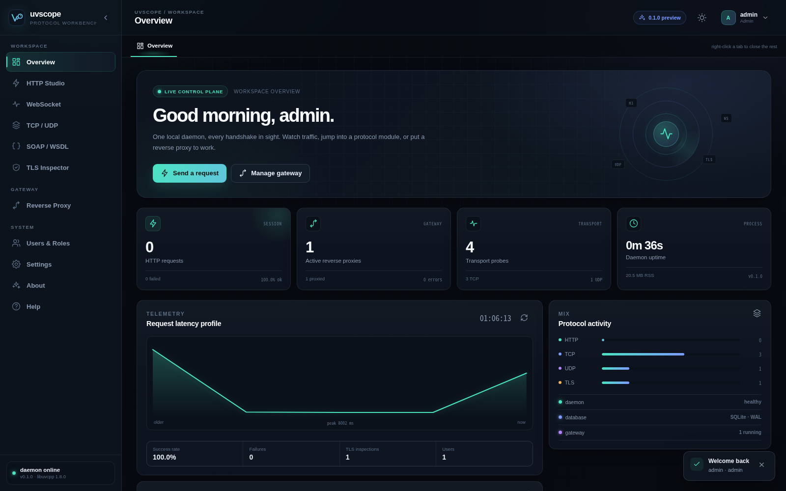
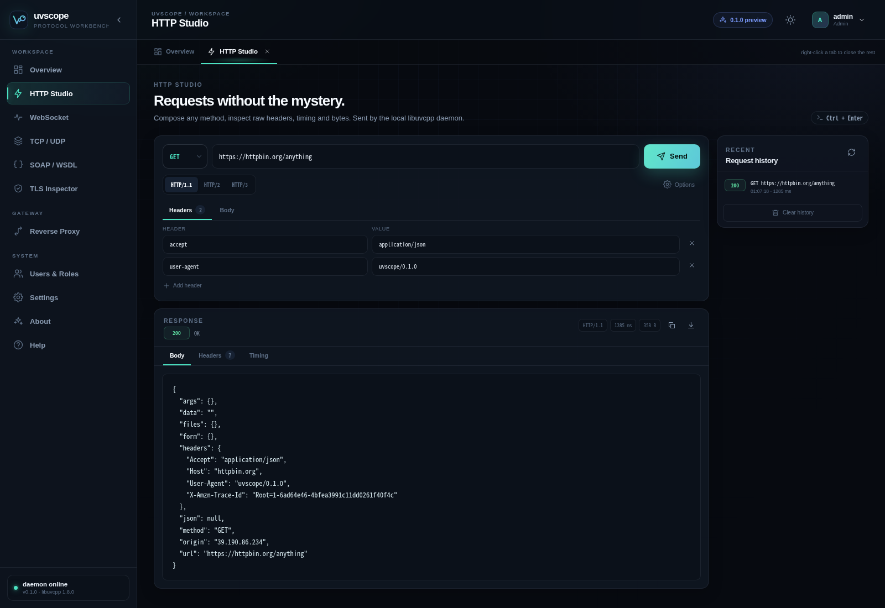
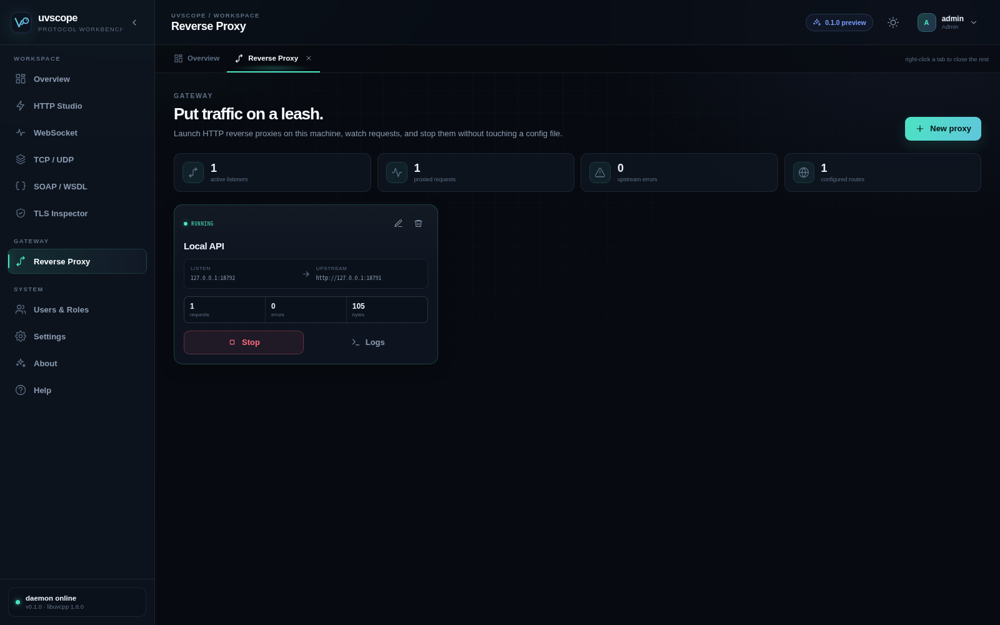
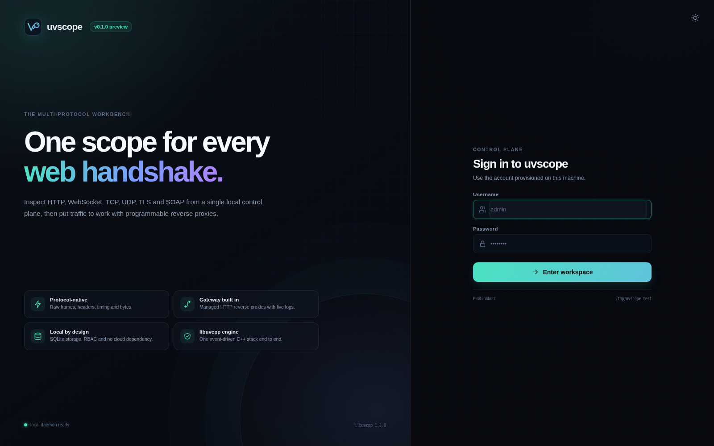

# uvscope

**A libuvcpp-powered, local-first multi-protocol web debugging workbench and gateway.**

[](https://github.com/Antruly/uvscope/actions/workflows/ci.yml)
[](LICENSE)

uvscope puts HTTP, WebSocket, TCP, UDP, TLS, SOAP/WSDL and managed reverse proxies behind one
Vue 3 control plane. A single C++ daemon owns the event loop, SQLite store, authentication and
all outbound network traffic; the browser only renders state and sends commands.



## Why another web debugger?

Most tools stop at request/response. uvscope is designed around the whole handshake:

- **Protocol workbench** — HTTP methods and headers, WebSocket frames, raw TCP/UDP payloads,
  X.509 certificate decoding and WSDL-driven SOAP calls.
- **Gateway in the same process** — launch HTTP reverse proxies, watch request traces, and stop
  them without editing nginx config or restarting the daemon.
- **Local-first security** — SQLite, server-side sessions, PBKDF2 password hashing, RBAC and a
  first-run administrator flow. No telemetry and no cloud account.
- **One network stack** — every outbound connection is driven by
  [libuvcpp](https://github.com/Antruly/libuvcpp) 1.8.2. One event-driven C++ stack from socket
  to UI.
- **A UI that keeps context** — collapsible navigation, cached multi-tab workspaces and live
  telemetry built with Vue 3, Pinia and Vite.



## What is in 0.5.1

| Area | Status |
| --- | --- |
| HTTP/1.1 request debugger with headers, body, timing and history | ✅ Stable |
| Request body modes: raw, form-urlencoded, multipart with files | ✅ New in 0.5.1 |
| gzip / deflate / brotli decoding with a raw-body toggle | ✅ New in 0.4.2 |
| Large-response streaming download with progress and cancel | ✅ New in 0.4.3 |
| HTTP/2 over TLS with ALPN, stream IDs, GOAWAY and frame summary | ✅ New in 0.4.0 |
| Response preview: sandboxed HTML, images, audio, video and PDF | ✅ Stable (opt-in scripts) |
| Chinese / English UI with browser-language detection and manual switch | ✅ Stable |
| Dark / light / follow-system theme | ✅ Stable |
| HTTPS with system CA bundle / explicit insecure mode | ✅ Stable |
| WebSocket console (browser-native, text + binary) | ✅ Stable |
| Backend WebSocket sessions: headers, frames, ping/pong, close codes | ✅ New in 0.4.3 |
| TCP and UDP one-shot probes (text / hex) | ✅ Stable |
| Persistent TCP sessions with repeated sends and event logs | ✅ Stable |
| TCP / UDP server listeners with sessions, datagrams and replies | ✅ Stable |
| SOCKS5 server (CONNECT / BIND / UDP ASSOCIATE) and outbound proxy | ✅ Stable |
| SOCKS5 per-session bytes, datagrams and duration | ✅ New in 0.4.0 |
| TLS certificate decoder (PEM / DER) and live peer-chain probe | ✅ New in 0.4.0 |
| TLS certificate vault: generate, import, inspect, download, delete | ✅ New in 0.4.0 |
| Virtual terminal (Unix PTY / Windows ConPTY) with command library | ✅ New in 0.4.0, off by default |
| SOAP 1.1 + WSDL operation discovery | ✅ Stable |
| Managed HTTP reverse proxy with live logs and routing rules | ✅ Stable (method/host/header conditions in 0.4.4) |
| Weighted upstreams with failover and retries | ✅ New in 0.4.4 |
| Per-proxy QPS, p50/p95 latency and status counts | ✅ New in 0.4.5 |
| Active upstream health checks (TCP/TLS, 10 s) | ✅ New in 0.4.5 |
| WebSocket pass-through in the reverse proxy | ✅ New in 0.4.5 |
| Audit log and active session revocation | ✅ New in 0.5.0 |
| SQLite persistence, local auth, roles, first-run setup | ✅ Stable |
| Module toggles, factory reset, update check, about/help | ✅ Stable |
| HTTP/3 and QUIC transports | 🧪 Experimental — needs an OpenSSL 3.6+ SDK build |
| QUIC client probe and echo server | 🧪 Experimental in the OpenSSL 3.6+/QUIC-enabled SDK |

HTTP/2 is the supported alternate transport: selecting H2 negotiates ALPN `h2` and returns the
stream ID, GOAWAY state and the first 200 received frames. HTTP/3 and raw QUIC remain closed in
release builds until the cross-platform matrix exists. The virtual terminal module is disabled by
default and limited to admin/operator roles because it grants shell access on the daemon host.

SOCKS5 outbound proxying is mandatory when configured: a failed handshake fails the request rather
than falling back to a direct connection.

## Screens

| Gateway | TLS Inspector |
| --- | --- |
|  |  |

## Download

Prebuilt **v0.5.1** assets are on the [Releases page](https://github.com/Antruly/uvscope/releases/tag/v0.5.1):

- Linux x64 / arm64: `.tar.gz`, `.deb`, `.rpm`
- Windows x64 (MinGW): `.zip` and `uvscope-0.5.1-setup.exe`
- macOS arm64: `.tar.gz` (Homebrew `libuv` and `openssl@3` are required)

The Windows executable and installer share the uvscope icon; Linux packages install the hicolor
icon set and a desktop entry with `Icon=uvscope`.

## Quick start

### Requirements

- C++17 compiler, CMake ≥ 3.20, Ninja
- Node.js 20+ and npm
- libuv, zlib, SQLite and OpenSSL development headers
- Linux, macOS, or Windows with MinGW-w64

On Debian/Ubuntu:

```sh
sudo apt install build-essential cmake ninja-build libuv1-dev zlib1g-dev \
  libssl-dev libsqlite3-dev git curl
```

### Build from source

```sh
git clone https://github.com/Antruly/uvscope.git
cd uvscope
./scripts/build.sh
./build/uvscope --port 8787 --open
```

`build.sh` clones the libuvcpp v1.8.2 release into `.deps/`, applies the minimal WebSocket
handshake-header patch from `patches/upstream/`, builds the frontend, then builds uvscope.

If you already have a libuvcpp 1.8.2 SDK:

```sh
npm --prefix web ci && npm --prefix web run build
cmake -S . -B build -G Ninja -DCMAKE_BUILD_TYPE=Release \
  -DUVCPP_ROOT=/path/to/libuvcpp
cmake --build build -j
./build/uvscope --self-check
```

Open <http://127.0.0.1:8787>. The first visit creates the administrator account. All runtime
state lives in the data directory printed at startup (`~/.local/share/uvscope` on Linux by
default).

### CLI

```text
uvscope [options]

  --host <addr>       Listen address (default 127.0.0.1)
  --port <port>       Listen port (default 8787)
  --data-dir <path>   SQLite and runtime data
  --web-root <path>   Built frontend directory
  --tls-cert <pem>    Serve the workbench UI over HTTPS
  --tls-key <pem>     Private key paired with --tls-cert
  --open              Open the workbench in the default browser
  --self-check        Run offline smoke tests and exit
  --version           Print version and exit
```

## Architecture

```text
Vue 3 SPA (multi-tab, cached workspaces)
        │  same-origin HTTP + cookies
        ▼
uvscope daemon (C++17 / libuvcpp)
  ├─ auth + RBAC + SQLite (single writer)
  ├─ HTTP API and static asset server
  ├─ protocol probes (HTTP/TCP/UDP/TLS)
  └─ reverse proxy runtimes (one libuv loop each)
        │
        └─ libuvcpp → libuv → sockets
```

The daemon is the only process that opens outbound sockets in the default Daemon mode. The
WebSocket view also offers a browser-native mode, because origin, mixed-content and certificate
prompts are part of what is being debugged.

See [`docs/ARCHITECTURE.md`](docs/ARCHITECTURE.md) for the data model and request flow.

## Security notes

- Default bind is `127.0.0.1`. Do not expose uvscope to an untrusted network.
- Passwords are PBKDF2-HMAC-SHA256 (210,000 iterations); sessions are server-side and stored as
  SHA-256 token hashes. Cookies are `HttpOnly` + `SameSite=Lax`.
- The reverse proxy and HTTP Studio can reach internal services. Treat access to uvscope as
  equivalent to code execution on the host network.
- Use the TLS Inspector and `Allow insecure TLS` only on systems you control.
- Report vulnerabilities privately as described in [`SECURITY.md`](SECURITY.md).

## Documentation

- [Development plan (中文)](docs/DEVELOPMENT_PLAN.zh-CN.md)
- [Architecture](docs/ARCHITECTURE.md)
- [HTTP API](docs/API.md)
- [Building and packaging](docs/BUILDING.md)
- [Roadmap](ROADMAP.md)
- [Agent guide](AGENTS.md)
- [Changelog](CHANGELOG.md)

## License

MIT. See [LICENSE](LICENSE).

If uvscope saves you a debugging session, a star on
[GitHub](https://github.com/Antruly/uvscope) helps other protocol wranglers find it.
